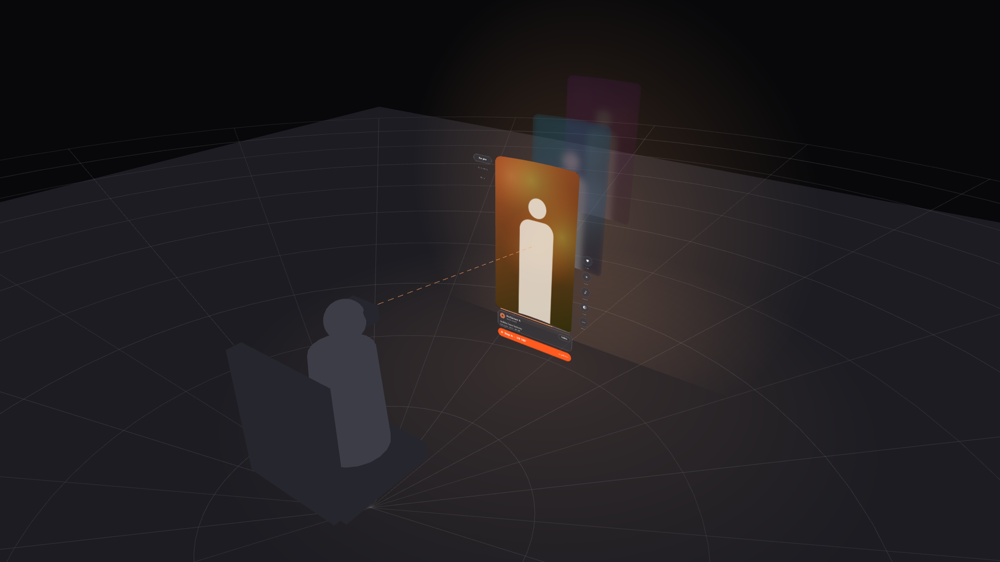
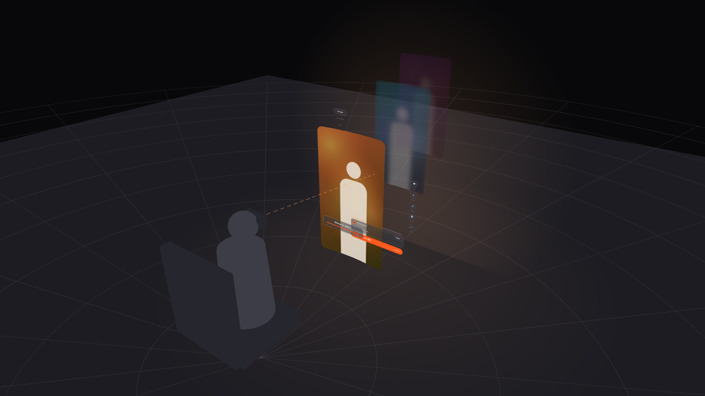
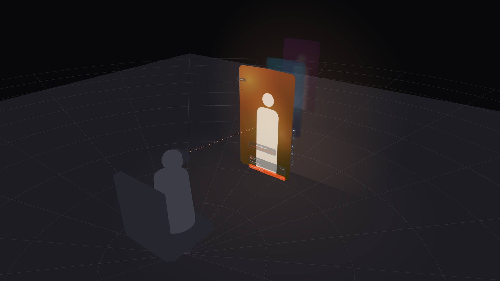
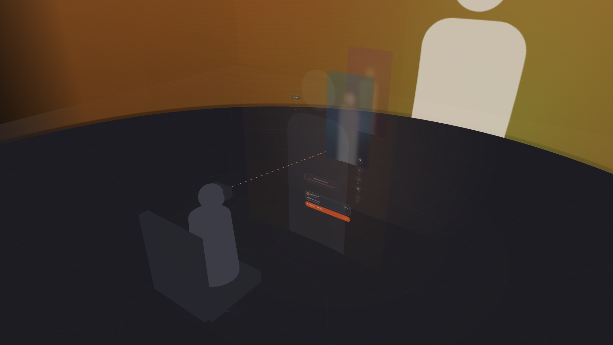
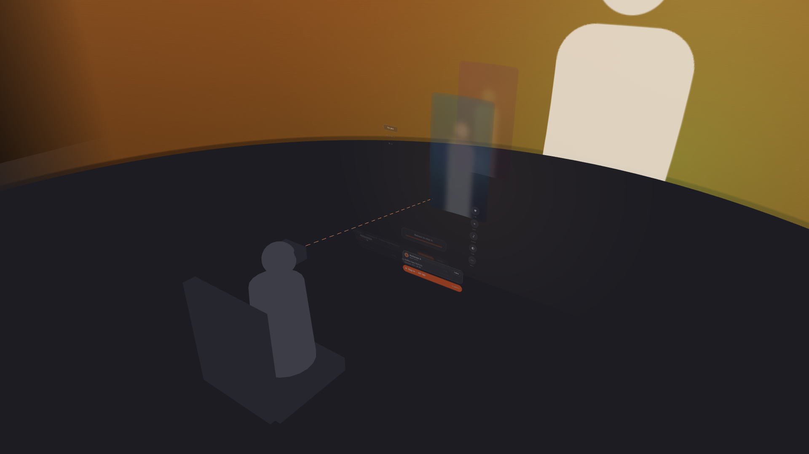

# Shorts in VR

**The short is the trailer. VR is the film.**

A take-home for SLR: bring the web Shorts feed into the VR app so it feels like it belongs there.

## The idea

Every short on the web already ends with "Watch full video". In VR that link becomes the main gesture.

1. **Browse.** One flat clip at a time, 1.6 m away, a little below your eyes. Controls sit outside the card, so nothing covers the video. The next clips wait behind it, blurred.
2. **Flick.** Right to like, left to skip, up to go back.
3. **Step in.** Pinch the card and pull it towards you. You land in the full 180° scene at the same second the short was cut from.

|  |  |  |  |
|:--:|:--:|:--:|:--:|
| Pull | Release | Wrap | 180° |

## Why depth, not a stack

Seated, your eyes are about 1.2 m off the floor. Stack 1.1 m cards vertically, like the web feed, and the next clip ends up in the floor. Queueing them behind keeps every card in view, and only the front one plays video.

## One model, two inputs

| | Hands | Controller |
|---|---|---|
| Like | Flick right | Stick → |
| Skip | Flick left | Stick ← |
| Previous | Flick up | Stick ↑ |
| Step in | Pinch, pull towards you | Grip + pull, A, or stick ↓ |
| Hide | Hide button | Hold B |

## Look

- **Design:** [Figma](https://www.figma.com/design/94B8znXNJOY4odQBBBUHrB/). Pages 0 to 4, in order.
- **Prototype:** `shorts-vr-prototype.html`, three.js with WebXR. Run `python -m http.server 5181` and open `localhost:5181/shorts-vr-prototype.html`. Drag the card, press `C` to change camera, `V` to toggle blur. Works in the Quest browser.
- **Thinking:** `docs/` holds the brief, decisions and trade-offs.
